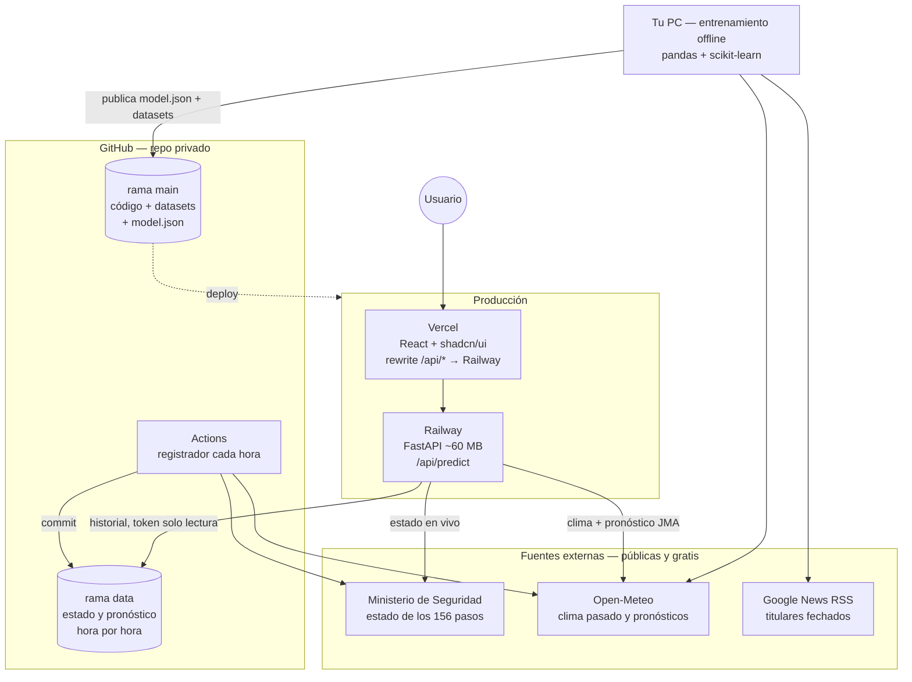
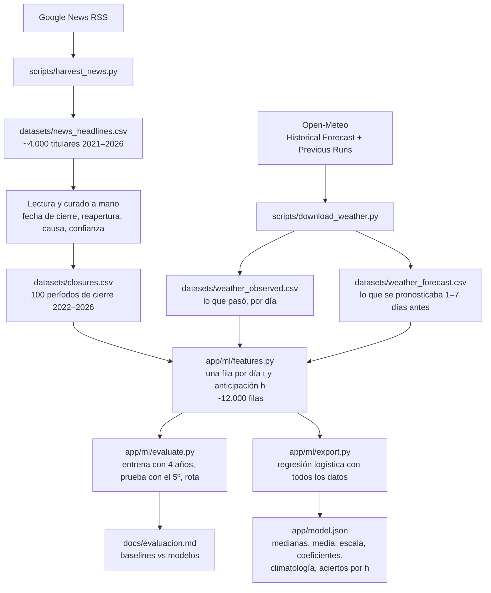
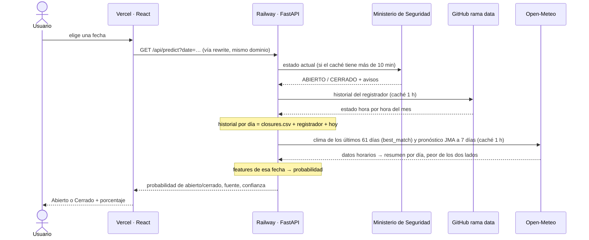
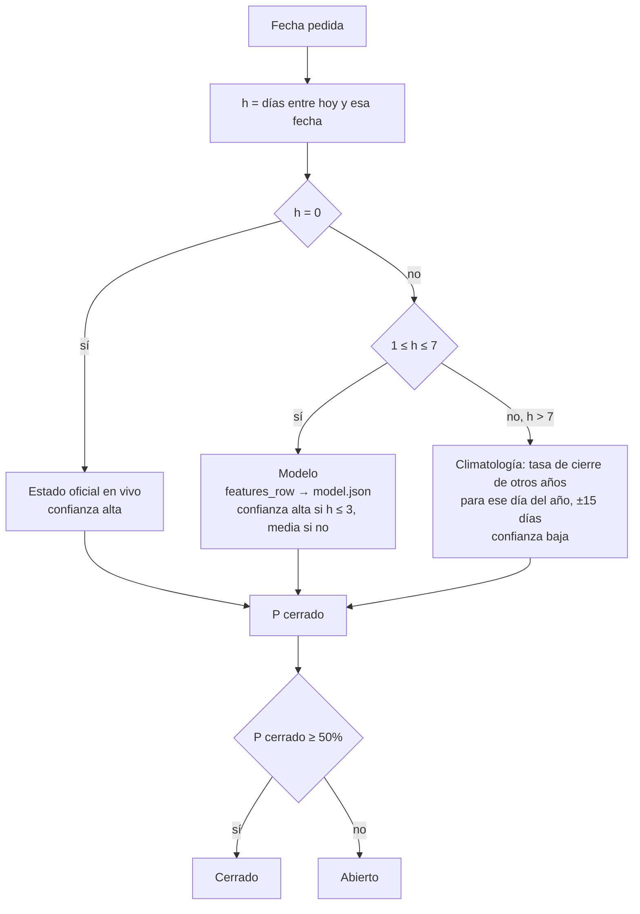

# Paso Cristo Redentor — predictor de apertura

Predice si el Paso Internacional Cristo Redentor (Los Libertadores) estará abierto en una fecha dada, con su probabilidad.

```
backend/
  app/
    main.py, api/   FastAPI y rutas HTTP
    collectors/     fuentes: estado oficial del paso, pronóstico Open-Meteo
    collect.py      registrador (lo corre GitHub Actions cada hora)
    store.py        lectura/escritura de los JSONL del registrador
    live.py         datos en vivo para predecir (con caché)
    predict.py      features + modelo en Python puro (producción)
    model.json      modelo exportado (coeficientes)
    ml/             entrenamiento: etiquetas, features, baselines, evaluación, export (pandas/sklearn)
  scripts/          descargas para armar datasets (titulares, clima histórico)
  tests/
frontend/           React + Vite + TypeScript
datasets/           datos para entrenar (ver datasets/README.md)
docs/               resultados de evaluación de modelos
data/               worktree de la rama `data` (no está en main)
TASKS.md            hoja de ruta
```

## Cómo funciona

El sistema tiene tres ciclos independientes: **registrar** (cada hora, automático), **entrenar**
(a mano, cada tanto) y **predecir** (cada vez que alguien abre la página).

### 1. Vista general



Las flechas van de quien pide a quien responde (los datos viajan en sentido contrario).

- **El registrador** ([collect.yml](.github/workflows/collect.yml)) guarda el estado oficial cada hora y el pronóstico
  cada 6 h en la rama `data` (archivos de texto que solo crecen, así no ensucian `main`). Si una fuente falla,
  guarda lo demás y el job queda en rojo → GitHub avisa por mail. Es el único dato que no se puede recuperar después.
- **El entrenamiento** corre en tu PC y su único producto para producción es `app/model.json` (5 KB).
- **El servidor** no entrena ni carga pandas/scikit-learn: lee el modelo exportado y pide los datos en vivo.
- Railway + Vercel es el despliegue previsto (tarea 10); hoy todo corre local igual.

### 2. Cómo se construye el modelo (ciclo de entrenamiento)



- **Etiquetas:** no existe un histórico oficial de cierres; se reconstruyó desde la prensa. Cualquier día que no
  figura en `closures.csv` se asume abierto. "Solo camiones" cuenta como cerrado (para un auto lo está).
- **Clima sin trampa:** para entrenar se usa lo que **se pronosticaba** en su momento (Previous Runs), no el clima
  que finalmente ocurrió; si no, el modelo aprendería con información que no va a tener al predecir.
  Se usa el modelo **JMA** porque es el único con pronósticos archivados desde 2022.
- **Evaluación:** se deja un año afuera por vez y se compara contra tres baselines (persistencia, climatología,
  Markov). Ganó la regresión logística, también contra gradient boosting.

### 3. Qué pasa en cada pedido (ciclo de predicción)



Con caché caliente la respuesta tarda ~10 ms; sin caché, ~1,3 s (hasta 7 pedidos: 1 al Ministerio,
1–2 a GitHub y 4 a Open-Meteo, dos por cada punto).

### 4. Cómo se decide cada día



Más allá de 7 días no hay pronóstico archivado para entrenar, y a 14 días el estado de hoy ya no aporta
(Markov empata con la climatología), así que lo honesto es devolver el promedio histórico.
La app muestra Abierto/Cerrado con el porcentaje; la API además devuelve `veredicto` con "incierto" entre 35% y 65%.

### 5. Qué ve el modelo

La predicción se considera emitida **al final del día t**, para el día **t+h**. Solo se usa lo que se sabe en ese momento:

| Grupo | Features | Dato que usa |
|---|---|---|
| Estado | cerrado hoy, solo camiones hoy, días seguidos en ese estado | historial hasta hoy |
| Clima pasado | nieve de los últimos 3/7/14 días, nieve en el suelo, días desde la última nevada ≥ 5 cm, temperatura mínima | observado **hasta ayer** |
| Pronóstico | nieve, precipitación, viento y temperaturas del día t+h; nieve acumulada y máxima entre t+1 y t+h | JMA emitido **hoy** |
| Época | seno y coseno del día del año de t+h | calendario |
| Interacciones | cerrado × precipitación, cerrado × nieve prevista, cerrado × días cerrado, h × precipitación | combinaciones de lo anterior |

Clima: se toma el **peor de los dos lados** (Las Cuevas y Portillo), porque el paso cierra si cualquiera no está transitable.

El modelo es una regresión logística. En producción ([predict.py](backend/app/predict.py)):

```
x   = valor de la feature (si falta → mediana del entrenamiento)
z   = intercepto + Σ coef · (x − media) / escala
P   = 1 / (1 + e^(−z))        → probabilidad de que esté cerrado
```

Un solo modelo cubre cierre y reapertura (el estado de hoy es una feature) y todas las anticipaciones (h es una feature).
Dos tests garantizan que producción y entrenamiento den lo mismo: [test_predict.py](backend/tests/test_predict.py)
compara features y probabilidades fila por fila, y [test_runtime_deps.py](backend/tests/test_runtime_deps.py)
verifica que el servidor no cargue pandas/scikit-learn.

**Resultados** (invierno, [docs/evaluacion.md](docs/evaluacion.md)): 87 % de aciertos a 1 día, 86 % a 3, 80 % a 7.
En los días en que el estado cambia, a 3 días acierta 68 % (el mejor baseline, 23 %).

## Datos

GitHub Actions ([collect.yml](.github/workflows/collect.yml)) corre el registrador cada hora (pronóstico cada 6 h)
y commitea en la rama `data`. Para tenerlos local, una sola vez:

```bash
git fetch origin data && git worktree add data data
```

Después, para actualizar: `git -C data pull`. No correr el registrador local sobre `data/`
(generaría conflictos con Actions); para probarlo usar otra carpeta: `PASO_DATA_DIR=/tmp/x python -m app.collect`.

## Correr

```bash
cd backend
python -m venv .venv && .venv/Scripts/activate   # Linux/mac: source .venv/bin/activate
pip install -r requirements-ml.txt   # servidor + pytest + lo necesario para entrenar
uvicorn app.main:app --reload  # API en :8000, lee ../data
python -m pytest
```

```bash
cd frontend
npm install
npm run dev                    # :5173, /api va al backend por proxy
```

## API

- `GET /api/predict?date=AAAA-MM-DD` → probabilidad de cerrado/abierto, veredicto, confianza y fuente
  (`estado_oficial` hoy, `modelo` a 1–7 días, `climatologia` más allá). Sin `date`: próximos 8 días.
- `GET /api/status` → estado oficial en vivo.

## Modelo

```bash
cd backend && pip install -r requirements-ml.txt
python -m app.ml.evaluate > ../docs/evaluacion.md   # comparar modelos
python -m app.ml.export                             # entrenar y exportar app/model.json
```

El servidor solo necesita `requirements.txt`: el modelo exportado corre en Python puro.
En producción, `GITHUB_TOKEN` (solo lectura del repo) permite leer el historial de la rama `data`.

## Fuentes
- Estado: `argentina.gob.ar/seguridad/pasosinternacionales/listado` (id 29).
- Pronóstico: [Open-Meteo](https://open-meteo.com), gratis y sin API key.
